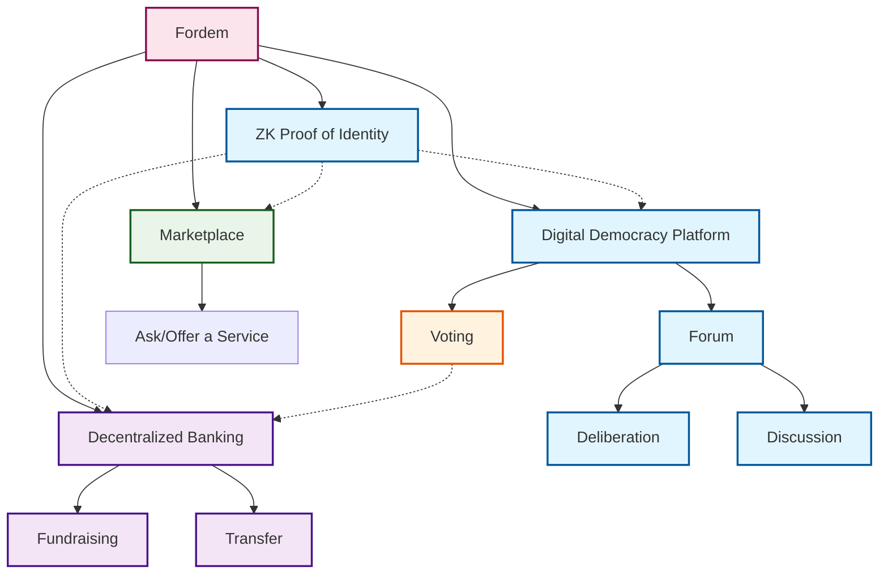

# For Democracy

Fordem is a digital democracy platform designed to make collective decision-making more engaging, flexible, accessible, and effective.  
It combines zero-knowledge proof of identity, computational social choice for collective decision-making, decentralized financial instrument and services, and artificial intelligence to facilitate community building, organization, and mobilization.

## Architecture

